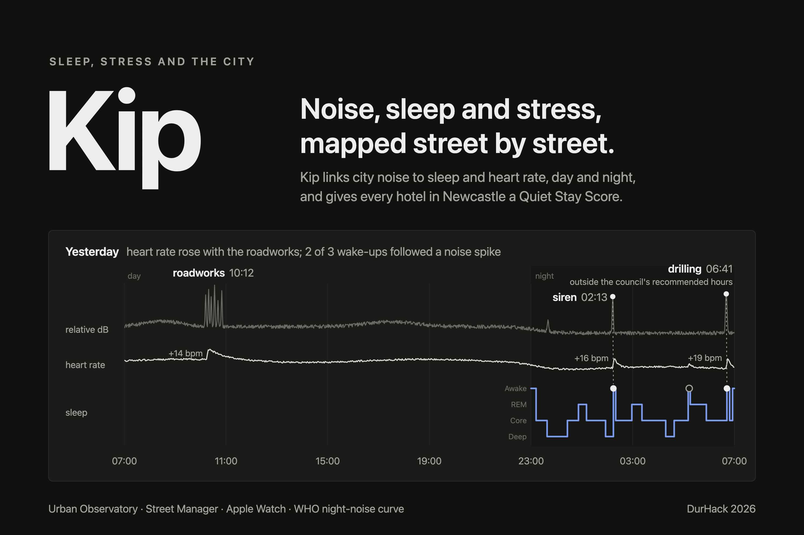
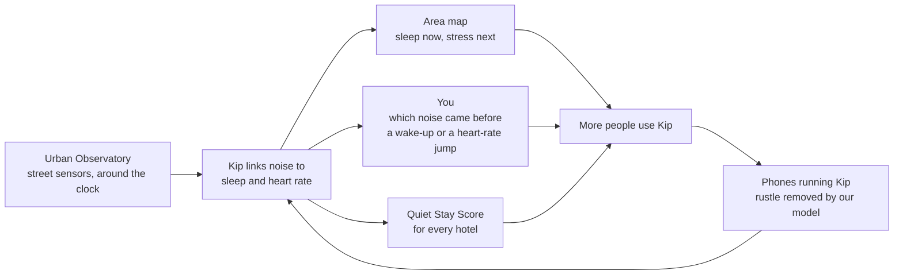
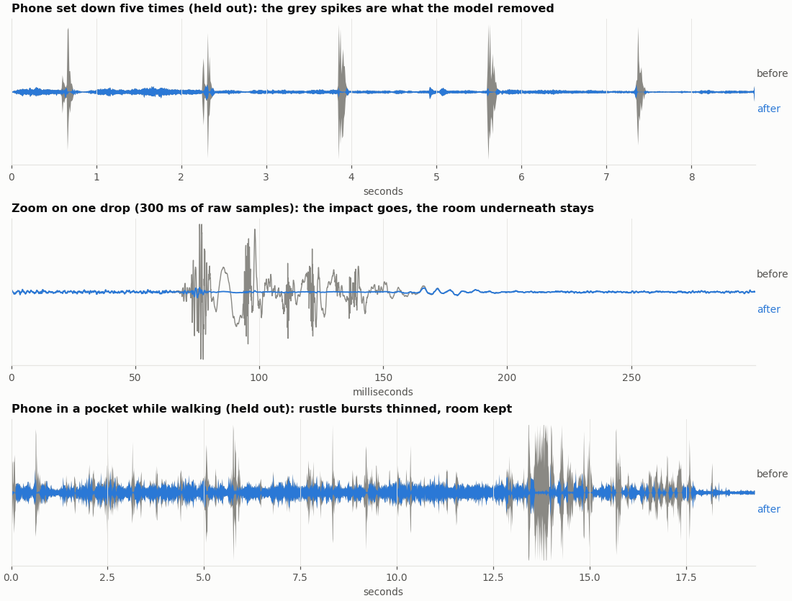

# Kip

**Noise, sleep and stress, mapped street by street.**

Cities measure noise. People live with it: roadworks outside the office, a bar under the bedroom
window, a siren at 2am. Nobody connects the noise to how people sleep and how stressed they feel.
Kip does, and every person who uses it makes the map better.

[Live demo](https://kip.edenmatrix.xyz) · [Devpost write-up](docs/demo/devpost.md) · Built in 24
hours at DurHack 2026 by Ellis and Nick

## Mission
Noise is one of Europe's largest environmental health costs, and it doesn't stop at bedtime. The
WHO estimates that western Europe loses at least a million healthy years of life to traffic noise
every year, through disturbed sleep, annoyance, heart disease and children's learning (*Burden of
disease from environmental noise*, 2011). Our goal is less stress and better sleep for people in
cities, day and night.

That starts with measuring noise where people actually are. City sensors are few, and they sit at
the kerb. Kip turns every phone that opts in into another sensor, at home, at work and on the
street, and links what it hears to sleep and heart rate. The more people use Kip, the denser the
network, and the clearer it becomes where noise is linked to poor sleep and stress.

## Every user is a sensor


## What it does
- **Area map.** Urban Observatory noise sensors across Newcastle, each shaded by an indicative
  estimate of nearby residents highly sleep disturbed (30 nights of night-time noise through the
  WHO road-traffic curve), with roadworks permits on top.
- **Noise, labelled.** Gemini labels each noise spike (construction, traffic, siren, snoring) and
  ElevenLabs Scribe gives a second opinion. Where they disagree, Kip says "uncertain", so your own
  snoring isn't blamed on the building site. Live, Kip labels a spike within seconds and checks it
  against the council's recommended hours for noisy work.
- **Your sleep.** Apple Watch sleep stages and heart rate beside bedroom noise in relative dB. Kip
  shows which wake-ups followed a noise spike, compared with random moments from the same night.
- **Briefing and evidence.** A spoken summary, a drafted report for the council, and the log's
  hash anchored on Solana (devnet for the demo), which proves when the log existed.
- **Quiet Stays.** Every hotel in Newcastle scored on the noise around it, roadworks on your
  dates, air quality and nights slept nearby by Kip users, then re-ranked for a light sleeper, a
  night out, best value or business, in one MongoDB geo pipeline.

Kip says "linked to", never "caused by", and every estimate is labelled indicative. Simulated
data, such as the other users on the map, is labelled simulated wherever it appears.

## Our model: a phone that doesn't hear itself
A phone in a pocket, on a desk or under a pillow mostly hears itself: sleeves, bags, bedsheets,
being picked up. Left in, that rustle becomes false spikes and false links to wake-ups, and a
phone is useless as a sensor. So we trained our own model to remove it.



| Held-out test mixtures (median of 150) | Kip's model | Standard noise gate |
|---|---|---|
| SI-SDR improvement | **+11.9 dB** | -3.9 dB, worse than doing nothing |

It removes 17.9 dB where there is handling noise and 0.15 dB everywhere else, so the sound around
the phone stays. On a real recording of a phone set down five times, it caught all five drops
(precision 0.96, recall 1.0), and it already thins the rustle of a phone in a pocket while
walking. It is a 0.42M-parameter PyTorch mask model, trained in 14 minutes on a Lium RTX 3090 for
$0.16 and exported to ONNX. Details: [ml/README.md](ml/README.md).

## What's next
1. **Stress, day and night.** Apple Watch heart rate and HRV through the day, linked to the noise
   around you, then mapped area by area. An indicator, not a diagnosis.
2. **More sensors.** Phones that sense through the day as well as overnight, so real readings
   correct the city estimate. Then cities beyond Newcastle.
3. **A business that pays for the network.** Affiliate commission on hotel bookings first, then
   Verified Quiet (hotels pay to replace the estimate with measured, room-by-room data), then
   area data for councils, developers and estate agents.

## Built with
Expo (iPhone and web) · TypeScript and Bun · tRPC on Hono · Tiger Data (TimescaleDB) · MongoDB
Atlas · Gemini · ElevenLabs · Solana · PyTorch and ONNX · Mapbox · Urban Observatory · Street
Manager · OpenStreetMap · Entire

## How Kip uses the sponsor tracks
**Solana: a timestamp nobody can quietly edit.** A noise complaint is only as strong as its log,
so Kip makes each night's log provable:
- The API serialises the night's log canonically, hashes it with SHA-256 and writes the hash to
  Solana with the Memo program (#71). We use plain JSON-RPC with no Anchor, so a transaction costs
  a fraction of a cent and confirms in seconds (#109).
- The council report links the memo on the Solana explorer (#72).
- The tamper check runs on stage: edit one value in a log, re-hash it, and it no longer matches its
  memo (#73).
- The memo proves when the log existed, not that the noise happened. The demo writes to devnet,
  and the same client targets mainnet by changing `SOLANA_RPC_URL`.

**ElevenLabs: Kip's voice and its second pair of ears.** Text to speech (`eleven_multilingual_v2`)
reads the morning briefing aloud in the app (#134, #133, #53). Scribe (`scribe_v3`) tags each
clip's audio events as a second classifier. Where it disagrees with Gemini, the event is marked
"uncertain", so your own snoring isn't blamed on the building site (#50). Sound Effects
(`eleven_text_to_sound_v3`) made the demo's drilling and siren clips (#58).

**Gemini: labels and words.** Gemini (`gemini-3.5-flash`, schema-checked JSON) labels every noise
clip as construction, traffic, siren, snoring or other, with a confidence, and the audio is deleted
once it is labelled (#94, #44). It does the same for live spikes in seconds (#55). It writes the
40-word morning briefing, and drafts that break Kip's wording rules are rejected (#134). It also
drafts the out-of-hours report for the council (#72).

**Tiger Data: every timestamped value.** Observatory readings land in the `sensor_readings`
hypertable every 5 minutes (#105), with 30+ nights backfilled (#33), next to each night's relative
dB, sleep stages and vitals (#107). The `sensor_lnight_daily` continuous aggregate computes each
sensor's Lnight per London night (23:00 to 07:00) as an energy average,
`10 * log10(mean(10^(L/10)))`, correct across clock changes and with real-time aggregation on top.
A 30-night query over it feeds the city estimate (#119). Deleting your account deletes your
series too (#130).

**MongoDB Atlas: users, nights, hotels and scores.** One `$geoNear` aggregation pipeline scores
every Newcastle hotel and re-ranks it for the chosen profile (#64).

**Entire: how two people ran many agents.** Every agent session is saved as a checkpoint, and
squash merges keep their `Entire-Checkpoint` trailers, so `entire why <file>:<line>` leads from a
line on `main` to the session that wrote it. Each PR gets a Trail. On larger issues, `entire
review` runs a Claude Code reviewer and a Codex reviewer with a Codex judge before the PR earns
`review:pass`. Agents run `entire brain brief` and `entire graph query` before changing code, and
record lasting decisions with `entire brain remember`. The Entire setup is pre-event tooling
(below). The sessions, Trails, reviews and memories are event work.

## How we built it
Two people, many agents. Ellis and Nick ran Claude Code, Cursor and Codex agents in parallel: one
GitHub issue, branch and pull request each, with Entire recording every session. More than 80
pull requests reached `main` in 24 hours.

## Pre-event tooling disclosure
MLH judges only work done during the event. One part of this repo was prepared before DurHack
2026: the framework we use to run coding agents in parallel. After an empty initial commit, it
arrived as the repo's first two merged pull requests (#1 and #4):

- the `hq` CLI, which runs the task queue on GitHub Issues: `tools/hq/`, `hq`, `hq.cmd`, `hq.json`;
- agent rules, skills and hooks: `AGENTS.md`, `CLAUDE.md`, `.agents/`, `.claude/`, `.codex/`,
  `.cursor/`, `.conductor/`;
- Entire's settings and agent guide (`.entire/`), the guard that blocks commits on `main`
  (`.githooks/`), the GitHub issue form, PR template and first CI workflow (`.github/`), and
  `.gitignore` and `.worktreeinclude`;
- `docs/PLAYBOOK.md`, and placeholder versions of the brief, spec, architecture and decision log.

Kip itself was written during DurHack: everything in `apps/`, `packages/`, `ml/` and `infra/`, the
`Dockerfile`, `compose.yaml`, and Kip's content in `docs/`. Changes to the framework files during
the event are event work, and the git history shows them.

## Run Kip locally
Kip is a Bun monorepo: one Expo app for the iPhone and the web dashboard (`apps/mobile`), one
server package with two processes, the API (tRPC on Hono) and the worker (`apps/server`), and
shared domain code (`packages/shared`). Details: [docs/ARCHITECTURE.md](docs/ARCHITECTURE.md).

You need Bun 1.4.4, Node.js LTS (the Expo CLI runs on it), Docker for the local databases, and
Python 3.9 or later for `./hq`.

```bash
bun install
cp .env.example .env    # works as is for local development; never commit .env
bun run db:up           # TimescaleDB (5432) and MongoDB (27017) in Docker; waits until healthy
bun run dev:api         # terminal 1: http://localhost:3000; applies migrations and indexes on boot
bun run dev:worker      # terminal 2: Observatory pull and Lnight refresh, every 5 minutes
bun run dev:app         # terminal 3: Expo dev server; press w to open the web dashboard
./hq check              # lint, typecheck and tests; CI runs the same command
```

`curl http://localhost:3000/health` answers `{"ok":true}` once the API is up.

What you should see on the web dashboard (http://localhost:8081):
- **City:** the Newcastle map once `EXPO_PUBLIC_MAPBOX_TOKEN` is set; without it, a message
  naming that variable. A sensor with fewer than 30 nights of history shows "not enough data".
- **Night:** a simulated night, labelled "Simulated night.", until a night is uploaded for your
  user.
- **Live** (http://localhost:8081/live): waits for the phone's levels. To send some by hand, 45
  seconds of quiet with one loud second:

  ```bash
  now=$(date +%s)
  body=$(bun -e "const t = $now - 45; console.log(JSON.stringify({ json: { samples: Array.from({ length: 45 }, (_, i) => ({ t: t + i, db: i === 40 ? 52 : 32 })) } }))")
  curl -s http://localhost:3000/trpc/live.push -H 'content-type: application/json' -H "x-kip-user: $(uuidgen)" -d "$body"
  ```

  The meter moves and one spike appears.
  Wait a minute before running it again, because each run covers the last 45 seconds. A
  development build that cannot reach the API plays a short simulated stream under a banner
  instead.

**Without Docker:** blank `MONGO_URI` and `TIGER_URI` in `.env`. The API then starts without
databases, with a warning for each, and still serves `/health`, the live stream and the stubs.
Anything that stores data, such as the Night tab or the account, returns an error. The worker
starts too, but its jobs fail every 5 minutes until the databases exist.

### Environment variables
Every variable is optional in development. Where to get each one: [docs/ARCHITECTURE.md](docs/ARCHITECTURE.md#env-vars).

| Variable | What it turns on |
|---|---|
| `PORT` | The API's port: 3000 by default |
| `MONGO_URI`, `TIGER_URI` | The local Docker databases by default. Production uses MongoDB Atlas and Tiger Cloud |
| `WEB_DIST` | The Expo web export the API serves as the dashboard. Unset in development |
| `GEMINI_API_KEY` (paid tier) | Clip labels and the briefing text. Without it, the briefing falls back to Kip's own template |
| `ELEVENLABS_API_KEY`, `ELEVENLABS_VOICE_ID` | The briefing voice and Scribe's second clip label. `briefing.get` fails without both |
| `SOLANA_RPC_URL`, `SOLANA_KEYPAIR` | Evidence anchoring: an RPC URL for the chosen network (devnet for the demo, mainnet for the real app) and a small funded keypair used only for memos |
| `EXPO_PUBLIC_API_URL` | Where the app finds the API: `https://kip.edenmatrix.xyz` for the live deploy. For a local server on an iPhone, use your Mac's LAN IP, not `localhost` |
| `EXPO_PUBLIC_MAPBOX_TOKEN` | Web map tiles: a public `pk.` token, restricted to the dashboard's URLs |
| `EXPO_PUBLIC_MAPBOX_MOBILE_TOKEN` | iPhone map tiles: a separate public `pk.` token with no URL restriction. Restart Metro after changing it |
| `VULTR_API_KEY`, `MONGODB_ATLAS_*`, `TF_VAR_*` | Terraform only: [infra/README.md](infra/README.md) |

### iPhone and deploy
The iPhone app needs a dev-client build (`cd apps/mobile && bun run ios`, with Xcode) because of
its native modules; Expo Go won't load it. Overnight recording is not built yet: the `kip-audio`
module is a skeleton (#59, #60). The live deploy at https://kip.edenmatrix.xyz runs through a
Cloudflare tunnel (`infra/tunnel/`), and GitHub Actions deploys `main` to it. Terraform for Vultr
in `infra/` is the alternative: [infra/README.md](infra/README.md) and
[docs/ARCHITECTURE.md](docs/ARCHITECTURE.md#deploy).

### If something fails
- `bun run db:up` reports a port in use: a local Postgres or MongoDB already holds 5432 or 27017.
  Stop it, then run `bun run db:up` again.
- The web dashboard cannot reach the API: check `EXPO_PUBLIC_API_URL` in `.env`, then restart
  `bun run dev:app`, which reads `.env` only when it starts.

## Quickstart
- Humans: [docs/PLAYBOOK.md](docs/PLAYBOOK.md) (kick-off checklist, dispatching agents, onboarding).
- Agents: [AGENTS.md](AGENTS.md) and the skills in [.agents/skills](.agents/skills).
- Hack context: [docs/hack/BRIEF.md](docs/hack/BRIEF.md), [docs/SPEC.md](docs/SPEC.md),
  [docs/BUSINESS.md](docs/BUSINESS.md), [docs/DOMAIN.md](docs/DOMAIN.md),
  [docs/ARCHITECTURE.md](docs/ARCHITECTURE.md), [docs/DECISIONS.md](docs/DECISIONS.md).
- First run in a clone: `entire enable`, then `./hq setup` (Windows: `hq.cmd setup`), then
  `./hq board`.
