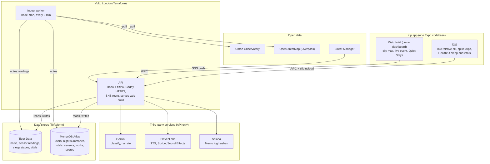

# Architecture

Source of truth for stack, file tree, lanes and contracts. Change a contract only through its own
issue. Product context: `docs/SPEC.md`. Science and wording rules: `docs/DOMAIN.md`.

## Overview
One Expo app builds both the iPhone app and the web dashboard used on stage. One TypeScript server
image runs two processes, the API (tRPC on Hono) and the ingest worker, on a Vultr instance in
London behind Caddy for HTTPS. Terraform provisions the instance, its firewall, the container
registry and the database access rules.



- The phone uploads each night through tRPC, and each spike clip through a plain upload route.
  In live demo mode it streams dB samples, and the web build subscribes to them.
- The worker pulls Observatory readings and OpenStreetMap venues every 5 minutes. The API receives
  Street Manager permits as they're pushed.
- **The API is the only thing that calls Gemini, ElevenLabs and Solana**, so keys live in one
  place. The app (iOS or web) never holds third-party keys.
- Every timestamped value goes in Tiger. MongoDB holds one summary document per night plus users,
  hotels, sensors, works and scores.

## Stack
Bun is the package manager and workspace tool everywhere, and the server runtime.

| Layer | Choice | Notes |
|---|---|---|
| App | React Native + TypeScript on Expo (SDK current at kick-off) with a dev client, Expo Router, TanStack Query + tRPC client | One codebase, two targets: iOS (the phone on the nightstand) and web (the demo dashboard). Needs an Apple developer account and the HealthKit entitlement |
| HealthKit | `@kingstinct/react-native-healthkit` with its Expo config plugin | Reads the Watch's sleep stages, heart rate, HRV and respiratory rate after the night ends |
| Audio | Local Expo Module `kip-audio` (Swift): AVAudioRecorder metering at 1 Hz, 10 s spike clips, on-device speech check (SoundAnalysis built-in classifier), background audio mode | No JS library does all of this reliably while locked; one small native module does |
| Map | MapLibre with OpenStreetMap tiles: `@maplibre/maplibre-react-native` on iOS, `maplibre-gl` on web, behind one `Map` component split by `.native.tsx` / `.web.tsx` | |
| watchOS (stretch) | Native SwiftUI watch target: haptics, "something woke me", briefing playback | Only if Watch signing works in the first 2 hours |
| API | TypeScript, tRPC v11 on Hono (`@hono/trpc-server`), Zod, SuperJSON | tRPC for every JSON call and the live subscription (SSE). Plain Hono routes only for binary clip upload, the Street Manager SNS endpoint, health check and the web build |
| Worker | TypeScript, node-cron, same image as the API | Runs each feature's jobs |
| Time series | Tiger Data (TimescaleDB): hypertables plus continuous aggregates | Event-window and night-average queries |
| Documents | MongoDB Atlas with 2dsphere indexes | Hotel ranking is one aggregation pipeline |
| AI | Gemini API on a paid-tier key, JSON output | Free-tier keys aren't allowed for UK-facing apps |
| Voice | ElevenLabs TTS (briefing), Scribe (second classifier), Sound Effects (demo clip) | |
| Chain | Solana mainnet, Memo program only (no Anchor) | A memo costs a fraction of a penny |
| Hosting | Vultr Cloud Compute (London), Vultr Container Registry, Caddy with an `<ip>.sslip.io` hostname | iOS requires HTTPS; no domain needed |
| Infra | Terraform: `vultr/vultr`, `mongodb/mongodbatlas` (IP access list), Tiger Cloud provider; cloud-init via `templatefile()` | One command rebuilds the stack |
| Quality | Biome (lint + format), `tsc -b` (typecheck), `bun test` | `./hq check` runs these once M0 adds them to `hq.json` |
| Process | Entire in the repo from the first commit | Records every agent session |

`./hq check` runs the `check` commands in `hq.json`. Keep it under ~2 min.
`./hq setup` runs the `setup` commands (`bun install`). Both are empty until M0 adds code.

## File tree
The tree is split **by feature first, then by layer**, so several agents can build different
features at once without touching the same files. A feature is one product capability end to end:
its screens, its tRPC router, its business logic, its jobs, its schemas and its tests.

```
apps/
  mobile/                         Expo app: iOS + web
    app/                          Expo Router routes. Thin: each file renders one feature screen
      _layout.tsx                 providers (tRPC, query client), written in M0
      (tabs)/_layout.tsx          tab list, written in M0 with every tab stubbed
      (tabs)/index.tsx            -> features/city
      (tabs)/night.tsx            -> features/night
      (tabs)/stays.tsx            -> features/stays
      live.tsx                    -> features/live
      ...
    src/
      features/
        <feature>/
          screens/                full screens, imported by app/
          components/             feature-only components
          hooks/                  tRPC queries and mutations for this feature
          native/                 device APIs; platform files *.ios.ts / *.web.ts
          index.ts                the feature's public exports
      lib/
        trpc.ts                   tRPC client, links, base URL
        ui/                       shared primitives (Button, Card, Text, theme)
        map/                      Map.native.tsx, Map.web.tsx
    modules/
      kip-audio/                  local Expo Module (Swift + TS bindings)
    app.config.ts                 plugins, permission strings, background modes
  server/                         one package, one Docker image, two entrypoints
    src/
      main.api.ts                 Hono app: /trpc, /upload/clip, /sns/street-manager, /health, web build
      main.worker.ts              registers every feature's jobs with node-cron
      env.ts                      Zod-validated environment
      trpc/
        init.ts                   initTRPC, context, procedures
        router.ts                 appRouter: one line per feature router, written in M0
      features/
        <feature>/
          router.ts               tRPC procedures. Thin: validate, call the service
          service.ts              business logic; the only thing other features may call
          repo.ts                 this feature's Tiger and Mongo queries
          jobs.ts                 optional cron jobs, exported as a list
          http.ts                 optional plain Hono routes (upload, SNS)
          *.test.ts               colocated tests
          index.ts                exports router, jobs, and the service functions others may use
      integrations/               one client per external API: gemini.ts, elevenlabs.ts,
                                  solana.ts, observatory.ts, overpass.ts, street-manager.ts
      db/
        tiger.ts, mongo.ts        clients; retry on boot
        migrations/               SQL, one file per change, timestamp-prefixed
        indexes.ts                Mongo collections and indexes
packages/
  shared/                         pure TypeScript, no IO; used by app and server
    src/
      <feature>/                  Zod schemas and types for that feature's inputs and outputs
      domain/                     WHO curve, Lnight, construction hours, attribution maths,
                                  score weights, wording strings, each with tests
infra/                            Terraform, cloud-init.yaml.tftpl, Caddyfile
Dockerfile                        builds server + Expo web export into one image
```

The app gets end-to-end types from `import type { AppRouter } from "@kip/server/trpc/router"`.
It never imports server runtime code.

### Features
| Feature | App (`apps/mobile/src/features/`) | Server (`apps/server/src/features/`) | Its data |
|---|---|---|---|
| `city` | City map screen | Sensors query, Observatory ingest job | 30-night Lnight and %HSD per sensor |
| `night` | Recording, upload, night timeline | Night upload, timeline query | Night documents and noise samples |
| `attribution` | Wake-up markers and counts on the timeline | Wake-up detection, spike vs random-window counts | Attribution results on a night |
| `labels` | Label chips on events | Clip upload route, Gemini + Scribe labelling, clip deletion | Event labels, `uncertain` logic |
| `briefing` | Briefing player | Gemini narrative, ElevenLabs TTS | Briefing text and audio |
| `evidence` | Evidence log, council report, verify view | Log hashing, Solana memo, complaint draft | Hashes, memo signatures |
| `stays` | Quiet Stays list, profile picker, score breakdown | Hotel ranking pipeline, OSM hotels and venues job | Hotels, venues, scores |
| `works` | Works layer on the map | Street Manager SNS route, permit storage | Works documents |
| `live` | Live demo screen (iOS sender, web viewer) | Live sample mutation and subscription | Live session state (in memory) |
| `account` | Onboarding, consent, delete everything | User, consent, profile, cascade delete | Users |

Construction-hours checks and the WHO curve live in `packages/shared/src/domain/`, since several
features and both apps use them.

### Rules that keep parallel agents apart
1. **Stay in your feature.** An issue names one feature. Its agent edits only that feature's
   folders in `apps/mobile`, `apps/server` and `packages/shared`, plus a new migration file.
2. **No reaching into another feature.** Import another feature only through its `index.ts`, and
   only service functions it exports. Never import its `repo.ts`, components or hooks. Need more
   from it? Open an issue for that feature.
3. **Registries are written once, in M0.** `trpc/router.ts`, `main.worker.ts`,
   `app/(tabs)/_layout.tsx` and the routes in `app/` are created with every feature stubbed, so
   feature work never edits them. Adding a feature later is its own issue.
4. **Shared code changes through its own issue:** `lib/ui`, `lib/map`, `trpc/init.ts`,
   `integrations/`, `db/` clients, `packages/shared/src/domain/`, `modules/kip-audio`,
   `app.config.ts`. Adding a new file in `integrations/` is fine; changing an existing one is not.
5. **Conflict-free by construction:** migrations are named
   `YYYYMMDDHHMM_<feature>_<what>.sql`; `env.ts` and `.env.example` take one line per variable,
   grouped by feature; never hand-merge `bun.lock`, rerun `bun install` instead.
6. **Platform splits by filename**, not `if (Platform.OS)` branches: `foo.ios.ts` and `foo.web.ts`.
   iOS-only features (recording, HealthKit) ship a `.web.ts` stub that renders "Open on iPhone".

## Lanes
Lanes are features. Both of us own every lane; lanes only exist so parallel issues touch
disjoint paths. Each lane covers that feature's folder in `apps/mobile/src/features/`,
`apps/server/src/features/` and `packages/shared/src/`. They are mirrored in `hq.json`.

| Lane | Dirs |
|---|---|
| `city`, `night`, `attribution`, `labels`, `briefing`, `evidence`, `stays`, `works`, `live`, `account` | `*/features/<lane>/`, `packages/shared/src/<lane>/` |
| `platform` | `apps/mobile/app/`, `apps/mobile/src/lib/`, `apps/mobile/modules/`, `apps/mobile/app.config.ts`, `apps/server/src/{trpc,integrations,db}/`, `apps/server/src/main.*.ts`, `apps/server/src/env.ts`, `packages/shared/src/domain/` |
| `infra` | `infra/`, `Dockerfile` |
| `demo` | `docs/demo/` (pitch, Devpost, demo clips, Entire evidence) |

## Contracts
Merge in M0, before anyone branches. Agree the night upload schema in the first 30 minutes so
recording and server work never block each other.

| Contract | Lives in | Lane |
|---|---|---|
| Night upload schema | `packages/shared/src/night/upload.ts` | `night` |
| Each feature's tRPC inputs and outputs | `packages/shared/src/<feature>/`, used by `features/<feature>/router.ts` | that feature |
| tRPC context, procedures, root router | `apps/server/src/trpc/` | `platform` |
| Domain constants (night window, spike threshold, attribution window, construction hours, WHO curve, score weights) | `packages/shared/src/domain/` | `platform` |
| `kip-audio` JS API | `apps/mobile/modules/kip-audio/index.ts` | `platform` |
| Tiger schema | `apps/server/src/db/migrations/` | the feature in the file name |
| Mongo collections and indexes | `apps/server/src/db/indexes.ts` | `platform` |

### Night upload (draft, settle at M0)
```ts
NightUpload = z.object({
  nightId: z.string().uuid(), userId: z.string().uuid(),
  startedAt: z.string().datetime({ offset: true }),       // Europe/London offsets
  endedAt: z.string().datetime({ offset: true }),
  location: z.object({ lat: z.number(), lon: z.number() }).optional(), // location consent only
  consent: z.object({ microphone: z.boolean(), health: z.boolean(), location: z.boolean() }),
  noise: z.object({ baselineDb: z.number(), samples: z.array(z.tuple([z.number(), z.number()])) }), // [epochSec, relative dB], 1 Hz
  spikes: z.array(z.object({ t: z.number(), peakDb: z.number(), clipId: z.string().optional() })),
  sleep: z.object({                                       // absent in live demo mode
    stages: z.array(z.object({ start: z.string(), end: z.string(),
      stage: z.enum(["inBed", "awake", "core", "deep", "rem"]) })),
    heartRate: z.array(z.tuple([z.number(), z.number()])),
    hrv: z.array(z.tuple([z.number(), z.number()])),
    respiratoryRate: z.array(z.tuple([z.number(), z.number()])),
  }).optional(),
})
```

### tRPC routers (draft)
| Router | Procedures |
|---|---|
| `night` | `upload` (mutation), `get`, `list` |
| `labels` | `forNight`; clip bytes go to plain `POST /upload/clip`, which labels and then deletes them |
| `attribution` | `forNight` |
| `briefing` | `get` (text and audio URL) |
| `evidence` | `anchor` (mutation), `verify`, `report` |
| `live` | `push` (mutation), `stream` (subscription over SSE) |
| `city` | `sensors` |
| `stays` | `rank({ profile, checkIn, checkOut, near? })` |
| `works` | `near`; permits arrive on plain `POST /sns/street-manager` |
| `account` | `me`, `setConsent`, `setProfile`, `deleteEverything` |

Auth for the hackathon: the app generates a user ID on first launch and sends it as a header;
`trpc/init.ts` puts it on the context. No accounts or passwords.

## Data
### Tiger (TimescaleDB)
| Table | Kind | Key columns | Feature |
|---|---|---|---|
| `sensor_readings` | hypertable | `time, sensor_id, metric (noise_db, no2, pm25), value` | `city` |
| `sensor_lnight_daily` | continuous aggregate | Energy-averaged noise per sensor per night window (see `docs/DOMAIN.md`) | `city` |
| `night_noise` | hypertable | `time, night_id, db` (relative) | `night` |
| `sleep_stages` | table | `night_id, start, end, stage` | `night` |
| `vitals` | hypertable | `time, night_id, metric (hr, hrv, resp), value` | `night` |

The 30-night Lnight per sensor is a query over `sensor_lnight_daily`. Backfill at least 30 nights
of Observatory history in hour one.

### MongoDB Atlas
| Collection | Holds | Indexes | Feature |
|---|---|---|---|
| `users` | Consent, profile choice | | `account` |
| `nights` | One summary per night: events, labels, attribution counts, hours flags, log hash, memo signature | `userId, startedAt` | `night` (others add fields through its service) |
| `sensors` | Observatory sensor, GeoJSON point, latest 30-night Lnight and %HSD | `2dsphere` | `city` |
| `hotels` | OSM hotel, GeoJSON point, placeholder booking link, `simulated` flags | `2dsphere` | `stays` |
| `venues` | OSM nightlife and sights | `2dsphere` | `stays` |
| `works` | Street Manager permits, geometry, proposed/actual times, night flag | `2dsphere` | `works` |

Hotel ranking is one pipeline: `$geoNear` on `hotels` first (only one is allowed, and it must be
the first stage), then `$lookup` with `$geoWithin` and `$centerSphere` into `sensors`, `works` and
`venues`, then the profile weights from `packages/shared/src/domain/`.

## Env vars
Secrets live in `.env`, never committed and never pasted into a prompt. Conductor copies `.env*`
into each new workspace via `.worktreeinclude`. For a plain git worktree, copy `.env` by hand.

| Name | Used by | Where to get it |
|---|---|---|
| `MONGO_URI` | API, worker | MongoDB Atlas cluster (MLH credit) |
| `TIGER_URI` | API, worker | Tiger Cloud service |
| `GEMINI_API_KEY` | API | Google AI Studio, **paid tier** (enable billing in hour one) |
| `ELEVENLABS_API_KEY` | API | ElevenLabs (MLH promo code) |
| `SOLANA_RPC_URL`, `SOLANA_KEYPAIR` | API | Mainnet RPC; a small funded keypair used only for memos |
| `STREET_MANAGER_TOPIC_ARN` | API | Street Manager open data registration (register in hour one) |
| `EXPO_PUBLIC_API_URL` | App | `https://<ip>.sslip.io`, or the local server in development. Not a secret |
| `VULTR_API_KEY` | Terraform | Vultr account (MLH credit) |
| `MONGODB_ATLAS_PUBLIC_KEY`, `MONGODB_ATLAS_PRIVATE_KEY` | Terraform | Atlas org API key |
| Tiger Cloud provider credentials | Terraform | Tiger Cloud console; names per the provider docs |
| `TF_VAR_admin_ip` | Terraform | Your public IP, for SSH |

Only `EXPO_PUBLIC_*` variables reach the app, and they end up in the bundle: never put a key there.

## Deploy
Either of us deploys. The demo runs from tag `demo-v1`.
- `infra/` holds Terraform: SSH key, private container registry, firewall (22 from `admin_ip`
  only; 80 and 443 open for Caddy), a `vc2-2c-4gb` Ubuntu 24.04 instance in `lhr`, and the Atlas IP
  access list for the instance's IP. Keys come from variables, never the repo.
- The `Dockerfile` builds the server and `expo export --platform web` into one image; the API
  serves the web build.
- cloud-init installs Docker and Caddy, builds an `<ip>.sslip.io` hostname from instance
  metadata, then pulls and runs the image twice (`main.api.ts` and `main.worker.ts`).
- The API retries its database connections on boot, because the Atlas access list is applied
  after the instance exists.
- The iOS app is a dev-client build installed on the demo phone; it is not deployed by Terraform.
- Demo: `terraform apply -replace=vultr_instance.api` rebuilds only the server; data stays put.
- To confirm against provider docs before relying on them: the Vultr region, the registry plan,
  and the registry `urn` attribute.
