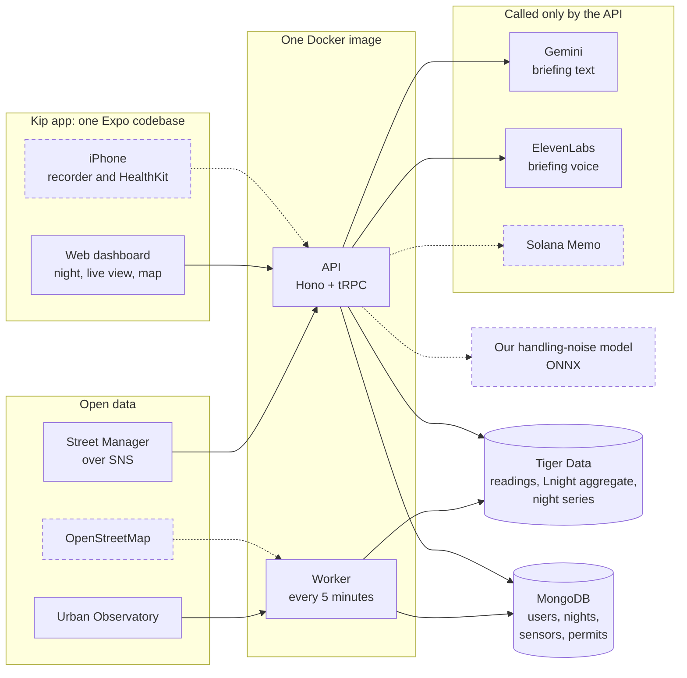

# Kip: Devpost submission

The text for Kip's Devpost page, one section per Devpost field. It was checked against `main` at
commit `de073c7` (2026-11-14). Anything not merged there is marked **planned**, with its issue or
PR. Simulated data is labelled simulated, and the wording follows `docs/DOMAIN.md`.

## Before you submit (Ellis and Nick)
Each item is still open. Tick it, or cut the claim it supports.

- [ ] **TODO:** At the code freeze, re-check every "Planned" line against `main`. Move what merged
      into "Works today" and cut what did not make it.
- [ ] **TODO:** Add the live URL under "Try it out" once Kip is deployed (#74). Nothing is
      deployed yet, so the Vultr entry describes infrastructure as code only.
- [ ] **TODO:** Add the backup demo video link (#80).
- [ ] **TODO:** Make the repository public after reviewing the Entire transcripts (#78). It is
      private today, so judges cannot open the code link yet.
- [ ] **TODO:** Enter only Best Use of MongoDB Atlas on Devpost. Each team may enter one sponsor
      track (confirmed 2026-11-14, `docs/DECISIONS.md`).
- [ ] **TODO:** Confirm the data lives in a MongoDB Atlas cluster (#8). It is our only prize
      entry, and local runs use a Docker container.
- [ ] **TODO:** Decide how much of the MongoDB fallback to build before the freeze (#149): the
      time series in MongoDB time series collections, and the hotel ranking as the centrepiece.
- [ ] **TODO:** Backfill 30 nights of Observatory history (#33). Until then every sensor reads
      "not enough data". On 2026-11-14 the only live Sound sensor sat 4.25 km from the city
      centre, outside the 3 km circle the worker reads, so check which noise sensors report.
- [ ] **TODO:** Import a night from a Health export (#48) for demo step 4. Nobody sleeps near an
      Observatory sensor during the event (`docs/DECISIONS.md`), and the Night tab shows a
      simulated night until a real one is stored.
- [ ] **TODO:** Add a source link for the Bewick Court story.
- [ ] **TODO:** Devpost does not render Mermaid. Export the diagram under "How we built it" as an
      image for the gallery.

## Project name
Kip

## Elevator pitch
Where in Newcastle would you sleep worst tonight? Kip links the city's night noise to sleep,
street by street.

## About the project

### Inspiration
Newcastle measures its night noise and people feel it, but nobody connects the two. The Urban
Observatory publishes kerbside noise levels and the WHO publishes how night noise disturbs sleep,
yet a resident can't tell what woke them, and a traveller can't tell that a hotel overlooks a
24-hour demolition site. Residents of Bewick Court were kept awake until 5am by demolition under a
24-hour permit, and no open dataset recorded it.

### What it does
Kip shows how the city's noise is linked to sleep, street by street. Each part below says what
works on `main` today and what is planned.

**City sleep map.** Every Urban Observatory noise sensor, shaded by an indicative estimate of
residents highly sleep disturbed, from its 30-night Lnight and the WHO road-traffic curve. The
sensors sit at the kerb and the curve is for long-term road-traffic noise at a home's facade, so
the map is an indicative road-traffic estimate, not a count of people kept awake.
- Works today: the worker pulls Observatory noise, NO2 and PM2.5 every 5 minutes into Tiger Data.
  A continuous aggregate computes each sensor's nightly Lnight, and every 5 minutes Kip writes the
  30-night Lnight and the indicative estimate onto each sensor in MongoDB, or "not enough data"
  below 30 nights. The web map renders Newcastle with Mapbox, given a public Mapbox token.
- Planned: the 30-night backfill (#33), serving the sensors to the app (#35, open PR #128) and
  shading them on the map (#36).

**Personal night.** Your night on one timeline: sleep stages from the Watch, bedroom noise in
relative dB from the phone, and each wake-up linked to the spike it followed. Kip compares the
wake-ups with 1,000 random moments from the same night and shows counts, such as "3 of 4 wake-ups
followed a spike", because one night is too few for a percentage. It claims a link, never a cause.
- Works today: the API stores an uploaded night (relative dB once a second, sleep stages and
  vitals in Tiger Data, a summary in MongoDB), keeping only the data types the upload has consent
  for. It counts the wake-ups that followed a spike against the random baseline. The Night tab
  draws the stages, the noise with its spikes, and the wake-ups.
- Planned: recording on the phone while it is locked (#38, #59, #60), reading HealthKit (#39),
  uploading the night (#40), and wake-up marks on the timeline (#43, open PR #137). Nobody sleeps
  near an Observatory sensor during the event, so the demo night will be imported from a Health
  export (#48).

**Morning briefing.** A short spoken summary when you wake, such as "Two wake-ups followed
drilling at 06:41, outside the council's recommended hours."
- Works today, in the API: Kip gathers the night's facts (counts, labels and hours flags, never
  handling noise or levels), Gemini writes at most 40 words, and a guard rejects any draft that
  uses a phrase Kip must never say. After two failed or rejected drafts Kip uses its own
  template. ElevenLabs then speaks the text.
- Planned: the route that serves the briefing audio (#133; written, not yet mounted), the in-app
  player (#53) and playback on Apple Watch (#75, a stretch goal).

**Live moment.** A drilling sound hits the phone, and within seconds Kip labels it, checks the
council's recommended hours and briefs you. This is the centre of the demo.
- Works today: the API takes the phone's levels once a second, finds spikes 10 relative dB above
  a 5-minute rolling median, checks each against Newcastle City Council's recommended hours for
  noisy work (Monday to Friday 08:00 to 18:00, Saturday 08:00 to 13:00, none on Sundays and bank
  holidays) and streams levels and spikes to the web dashboard.
- Planned: the phone sending its levels (#57), and labelling live spikes with Gemini and briefing
  within seconds (#55). Until then a live spike arrives labelled `uncertain`. The demo's drilling
  clip will come from ElevenLabs Sound Effects (#58).

**Quiet Stays.** Hotels ranked by how well you are likely to sleep there, for your profile: light
sleeper, night out, best value or business. The Quiet Stay Score (0 to 100) is an indicative
estimate of a hotel's surroundings, not of a room, with its sources one tap away.
- Works today: the score's maths, profile weights and wording, and the ranking payload with
  example fixtures, in the shared package. The fixtures are simulated and flagged as simulated.
- Planned: loading OpenStreetMap hotels and venues (#62), the MongoDB ranking pipeline (#63), the
  page with its profile switch (#64), and the sources and search areas behind each score (#115,
  #117, #118). Booking links are placeholders by design, because affiliate approval takes weeks.

**Roadworks.** DfT Street Manager pushes street and road works permits over AWS SNS.
- Works today: the SNS route checks each message's signature, confirms the subscription, stores
  Newcastle permits with their geometry in MongoDB, and finds the permits near a point whose dates
  overlap a stay.
- Planned: a recorded sample of Newcastle permits (#67, in progress) and the works layer on the
  map (#68, #113). Live permits need the open data registration (#8) and a public HTTPS endpoint
  (#74).

**Evidence log.** Each night's log, hashed with SHA-256 and written to Solana mainnet with the
Memo program, then a tamper check on stage. A memo proves when the log existed, not that the noise
happened.
- Works today: a Memo client that writes a memo transaction and reads it back by signature, with
  no Anchor (#109). It is tested against a mocked RPC and has not yet sent a transaction on
  mainnet.
- Planned: hashing and anchoring each night's log (#71), the tamper check (#73), and Gemini's
  draft of the out-of-hours report for the council (#72).

**Privacy.** Sleep and heart data are special-category health data under UK GDPR.
- Works today, in the API: consent per data type (microphone, HealthKit, location), a traveller
  profile, and one action that deletes everything a user has in both databases. Kip keeps no raw
  audio at rest.
- Planned: the consent screens on first launch (#70, in progress), dropping clips with speech on
  the phone (#61), and deleting each clip once it is labelled (#44).

**Our own model.** A phone on a nightstand or under a pillow hears itself: sleeves, pockets and
bedsheets make spikes that would be labelled and linked to wake-ups. We trained a small model that
finds and removes that handling noise.
- Works today: a 0.42M-parameter mask model, trained in 14 minutes on a Lium RTX 3090 pod for
  $0.16, on our own venue recordings, ESC-50 night sounds and placeholder synthetic clips. On
  held-out mixtures it beats a spectral noise gate and flags handling frames with F1 0.91. On a
  real held-out phone take with five drops it flagged all five (precision 0.96, recall 1.0);
  other takes score lower (`ml/reports/handling-gpu/`). It is exported to ONNX, and a notebook
  shows the audio before and after.
- Planned: the ONNX export with feature extraction inside the graph (#88, open PR #131), then
  running it in the API on each spike clip before Gemini (#90, #91).

### What is real, what is simulated
| Data | Status | Where |
|---|---|---|
| Observatory noise, NO2 and PM2.5 | Real, pulled every 5 minutes from the Urban Observatory API | `apps/server/src/features/city/` |
| City estimate per sensor | Real calculation; "not enough data" until a sensor has 30 nights (backfill: #33) | `sensor_lnight_daily` in Tiger Data |
| Council hours and bank holidays | Real: Newcastle City Council's recommended hours, England bank holidays from gov.uk | `packages/shared/src/domain/` |
| Night on the Night tab | **Simulated**, labelled "Simulated night." on screen, until a real night is stored, such as one imported from a Health export (#48) | `apps/mobile/src/features/night/data/fixture.ts` |
| Demo nights in tests | **Simulated** fixtures, which disagree on which wake-ups are linked (#135) | `packages/shared/src/night/fixtures/` |
| Live dashboard | Real when the API is running. A development build that cannot reach the API plays a short **simulated** stream under a "Simulated stream" banner | `apps/mobile/src/features/live/` |
| Labels on live spikes | `uncertain` until live labelling lands (#55). The "construction" label appears only in the simulated stream | |
| Quiet Stays hotels and scores | **Simulated** fixtures, flagged `simulated: true`, with placeholder booking links | `packages/shared/src/stays/fixtures/` |
| Street Manager permits | **Simulated**: 22 Newcastle permits in the SNS message format, signed in tests with a throwaway certificate. No live subscription yet; a recorded sample is in progress (#67) | `apps/server/src/integrations/fixtures/street-manager/` |
| Opted-in nights near hotels | Planned as a **simulated** cohort, always labelled simulated (#47) | |
| Handling-noise training audio | Our own phone recordings, ESC-50 clips (CC BY-NC) and procedural placeholder clips | `ml/audio/` |
| Demo drilling clip | Planned: generated with ElevenLabs Sound Effects (#58) | |

### How we built it

Dashed: planned. Nothing on `main` uses these yet, although the OpenStreetMap and Solana clients
exist.

- **Stack.** A Bun monorepo in TypeScript. One Expo (React Native) codebase builds the iPhone app
  and the web dashboard. The API is tRPC on Hono, and a node-cron worker runs from the same Docker
  image. Tiger Data (TimescaleDB) holds every timestamped value and MongoDB holds documents and
  geo queries. Terraform describes the Vultr server.
- **The science is code.** The WHO curve, Lnight, the night window, construction hours, spike
  detection, the attribution maths, the score weights and the wording rules live in one shared
  package with tests, used by both the app and the server.
- **Our model.** PyTorch, trained on a Lium GPU pod and exported to ONNX (`ml/`).
- **Two people, parallel agents.** Ellis and Nick ran Claude Code and Cursor agents side by side:
  one GitHub issue, one branch and one PR each, coordinated by our `hq` CLI. The code is split by
  feature, so parallel agents rarely touch the same files. Entire recorded the sessions, gave each
  agent a Brain brief and Graph queries before it edited, and reviewed PRs with Claude Code and
  Codex. The agent framework was prepared before the event and is disclosed in the README.

### Challenges we ran into
- **Sensors that are there, but quiet.** On the day, the only live Observatory Sound sensor sat
  4.25 km from Grey's Monument, outside the 3 km circle the worker reads, and the Sound series
  lagged the API clock by about an hour. The worker looks back 3 hours, and the 30-night backfill
  is next.
- **A night that crosses the clocks.** Lnight is an energy average over 23:00 to 07:00 London
  time, including the nights the clocks change. TimescaleDB rejects a time bucket with both an
  offset and an origin, so the aggregate counts London days from a 07:00 origin instead.
- **The phone hears itself.** Handling noise makes spikes that would be linked to wake-ups, so we
  trained our own filter. The `handling` label is never linked to a wake-up or spoken in a
  briefing.
- **A loud venue.** Our recordings were full of other people talking. We scanned every take with
  Apple's sound classifier, cut the speech from committed clips, and kept recordings that were
  mostly conversation out of git.
- **Claims that survive judges.** One night has 2 to 6 wake-ups, the phone microphone is not
  calibrated, and the WHO curve is for road traffic at the facade. So Kip shows counts against a
  random baseline, relative dB and an indicative map, and its wording rules are code: a tested
  list of phrases Kip never says, which also screens every Gemini draft.

### Accomplishments that we're proud of
- The science and the wording rules sit in one tested package that the app and the server share,
  so the claims on screen and in the briefing come from the same rules.
- Our own model: trained for $0.16 of GPU time, it beats a spectral noise gate on held-out audio.
- Two people and their agents built Kip in parallel, and every change reached `main` through a
  pull request.

### What we learned
- Writing the contracts first (the night upload schema, each payload with a fixture) let the app
  and the server start at the same time.
- Wording rules are cheaper as code than as review comments.
- Open data is only as live as its sensors: check what reports before building on it.

### What's next for Kip
1. Finish the live moment: phone streaming (#57), live labels and briefing (#55), and the
   briefing player (#53, #133).
2. A real night end to end: the recorder (#38, #59, #60, #61), HealthKit (#39), upload (#40) and
   clip labels (#44).
3. The city map: backfill (#33) and shading (#35, #36).
4. Quiet Stays as the centre of our MongoDB entry (#62, #63, #64, #149), the evidence log on
   Solana (#71, #73) and the deploy (#74).
5. The business: affiliate commission at launch, Verified Quiet in year one (hotels pay to replace
   the estimate with measured, room-by-room data), and area-level data licensing for councils and
   developers later. Renters choosing a flat may be a bigger market than hotel guests; that is a
   hypothesis, not a finding.

## Built with
bun, typescript, react-native, expo, expo-router, tanstack-query, trpc, hono, zod, timescaledb,
tiger-data, mongodb, gemini, elevenlabs, mapbox, maplibre, openstreetmap, urban-observatory,
street-manager, aws-sns, solana, pytorch, onnx, python, uv, lium, docker, caddy, terraform,
vultr, github-actions, biome, entire, claude-code, cursor, codex

## Try it out
- Code: https://github.com/ehewes/durhack-proj (private until the transcripts are reviewed; see
  the TODOs above)
- Run it locally: `README.md`, "Run Kip locally"
- **TODO:** live demo URL (#74)
- **TODO:** backup video (#80)

## Prize tracks
Each team may enter one sponsor track (confirmed 2026-11-14), so Kip enters **Best Use of MongoDB
Atlas** (`docs/DECISIONS.md`). The other sponsors' technology is still part of Kip. For every
track in the prize table in `docs/hack/BRIEF.md`, here is what Kip uses today and what is planned.

### Our entry: Best Use of MongoDB Atlas
Used today:
- Kip's documents, with collections and indexes ensured on every API boot: users with their
  consent and profile (#130), one summary per night (#107), Observatory sensors with their 30-night
  Lnight and indicative estimate (#119), and Street Manager permits (#106). Sensors, hotels,
  venues and works carry `2dsphere` indexes.
- Geo queries: `works.near` finds permits within a radius with `$near` on the works `2dsphere`
  index (#106).
- One action deletes everything a user has, in MongoDB and in Tiger Data (#130).

Planned:
- The hotel ranking pipeline: `$geoNear` on hotels, then `$lookup` with `$geoWithin` into sensors,
  works and venues, weighted by profile (#63), over OpenStreetMap hotels and venues (#62).
- The MongoDB fallback in `docs/DECISIONS.md`: the time series in MongoDB time series collections,
  and the hotel ranking as the centrepiece. How much of it lands before the freeze is still open
  (#149).
- **TODO:** confirm the data lives in an Atlas cluster (#8); local runs use the `mongo:8` Docker
  image.

### Not entered: the other sponsor tracks

#### Best Use of ElevenLabs
Used today:
- The morning briefing's voice: the API sends Gemini's briefing text to ElevenLabs text to speech
  (`eleven_multilingual_v2`) and keeps the mp3 in memory for that night (#134).
- One client for the three ElevenLabs APIs Kip needs: text to speech, Scribe audio-event tags
  (`scribe_v3`) and Sound Effects (`eleven_text_to_sound_v3`), tested against mocked responses
  (#93).

Planned:
- Serving and playing the briefing: the audio route (#133) and the player (#53).
- Scribe as a second classifier: where it disagrees with Gemini, the event becomes `uncertain`
  (#50). This stops a user's own snoring being blamed on the building site.
- The demo's drilling and siren clips, made with Sound Effects (#58).

#### Best Use of Gemini API
Used today:
- Gemini writes the morning briefing (`gemini-3.5-flash`, JSON output, a paid-tier key) within
  40 words and Kip's wording rules; drafts that break them are rejected (#134).
- A client that labels a noise clip (construction, traffic, siren, snoring or other, with a
  confidence) and generates schema-checked JSON (#94).

Planned:
- Labelling each uploaded spike clip, then deleting the audio (#44), and labelling live spikes in
  the demo (#55).
- Drafting the out-of-hours report for the council (#72).

#### Best Use of Entire
Used today:
- Sessions: agent sessions are saved as checkpoints on the `entire/checkpoints/v1` branch, and
  squash merges keep their `Entire-Checkpoint` trailers, so `entire why <file>:<line>` can lead
  from a line on `main` to the session behind it.
- Trails: Entire opens a Trail for each PR. `entire review` runs a Claude Code reviewer and a
  Codex reviewer with a Codex judge, and posts its findings to the Trail before a PR on a larger
  issue gets `review:pass`.
- Graph and Brain: the agent rules make every agent run `entire brain brief` and then
  `entire graph query` before it changes code, and record lasting decisions with
  `entire brain remember`.
- The Entire setup (settings, review profile, agent guide) is part of the pre-event framework
  disclosed in the README. The sessions, Trails, reviews and memories are event work.

Planned:
- The evidence slide (#78): `entire why` on a key line, `entire graph stats`,
  `entire dispatch --local`, and the token savings from `entire session tokens`.
  **TODO:** add the numbers here.

#### Best Use of Solana
Used today:
- A Memo client that writes a memo transaction to mainnet and reads it back by signature, over
  plain JSON-RPC with no Anchor (#109). It is tested against a mocked RPC and has not yet sent a
  transaction on mainnet.

Planned:
- Each night's log serialised canonically, hashed with SHA-256 and written to mainnet with the
  Memo program (#71). Then the tamper check on stage: edit a log, re-hash it and show it no longer
  matches its memo (#73). A memo proves when the log existed, not that the noise happened.

#### Best Use of Tiger Data
Used today:
- Every timestamped value: Observatory readings in the `sensor_readings` hypertable, written every
  5 minutes (#105), and each night's relative dB, sleep stages and vitals (#107).
- The `sensor_lnight_daily` continuous aggregate: each sensor's Lnight per London night (23:00 to
  07:00) as an energy average, `10 * log10(mean(10^(L/10)))`, correct across clock changes and
  refreshed every 5 minutes, with real-time aggregation on top. A 30-night query over it feeds the
  city estimate (#119).
- Deleting a user removes their night series from Tiger Data as well as MongoDB (#130).

Planned:
- The 30-night backfill (#33). If the MongoDB fallback moves the time series (#149), update this
  section. **TODO:** confirm the Tiger Cloud service (#8); local runs use the TimescaleDB Docker
  image.

#### Best Use of Vultr
Used today:
- Terraform in `infra/` describes the server: an SSH key, a private Container Registry, a firewall
  group (SSH from the admin IP only, 80 and 443 for Caddy), a reserved IPv4, a `vc2-2c-4gb`
  Ubuntu 24.04 instance in London, and the MongoDB Atlas access entry for its IP. cloud-init
  installs Docker, writes the Caddyfile and compose file, and derives an `<ip>.sslip.io` hostname
  for HTTPS.
- One Docker image runs the API, the worker and the web dashboard. CI checks the Terraform,
  renders cloud-init and builds the image on every PR.

Planned:
- The first `terraform apply`, then rebuilding the server live with
  `terraform apply -replace=vultr_instance.api` while the data stays put (#74). Nothing is
  deployed yet.

#### DEV Writing Challenge
Planned after submission: a DEV post about building Kip with parallel agents (#79). **TODO:**
check whether the one-track limit covers it.
