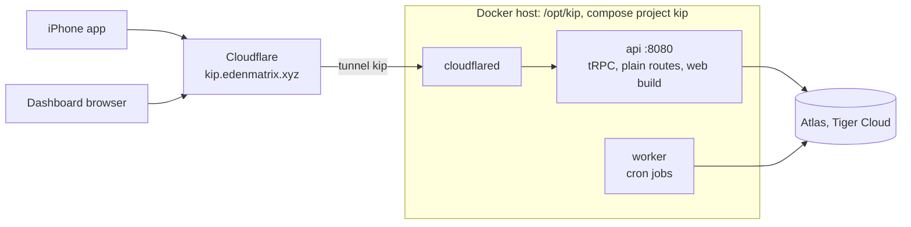

# Infra

Two ways to run Kip's server, both from the one `Dockerfile` image:
- **Cloudflare tunnel** (`tunnel/`): the live deploy at `https://kip.edenmatrix.xyz`, a compose
  stack on a shared Docker host.
- **Terraform on Vultr** (the rest of this folder): a Vultr instance in London behind Caddy, its
  firewall, a private container registry, and the MongoDB Atlas access entry for the instance's
  IP. Tiger Cloud is passed in as a URI.

Architecture and the deploy flow: `docs/ARCHITECTURE.md` ("Deploy").

## Cloudflare tunnel: kip.edenmatrix.xyz
The API (which also serves the web build), the worker and Kip's own `cloudflared` run as compose
project `kip` on the shared Docker host (`ehewesagents`, Debian, amd64). No service publishes a
port: `cloudflared` dials out to Cloudflare, and Cloudflare ends TLS.



| Piece | Where |
|---|---|
| Tunnel `kip`, remotely managed | Zero Trust, Networks, Tunnels. Route `kip.edenmatrix.xyz` to `http://api:8080`, then `http_status:404` |
| DNS | Proxied CNAME `kip.edenmatrix.xyz` to `<tunnel id>.cfargotunnel.com` |
| Compose files | `tunnel/compose.yml` (api, worker) and `tunnel/compose.tunnel.yml` (cloudflared), installed as `/opt/kip/deploy/` |
| Settings | `/opt/kip/.env` on the host only, mode 600: `CLOUDFLARE_TUNNEL_TOKEN` and the server variables |
| Image | `kip/server:<commit>`, built on the host. `kip/server:live` is the one that runs |

### Ship a build
```bash
infra/tunnel/deploy.sh             # HEAD, or a ref: infra/tunnel/deploy.sh demo-v1
```
It ships the committed tree over ssh (`git archive`, so uncommitted changes stay behind), builds
the image on the host, restarts the stack with `docker compose up --wait`, checks `/health` and
the web build from inside the API container, then checks `https://kip.edenmatrix.xyz/health`
through Cloudflare. `DEPLOY_HOST` overrides the ssh host (default `ehewesagents`). The ssh user
needs Docker and must own `/opt/kip`.

A build whose image is unchanged (docs or `infra/` only) leaves the containers running. One that
changes the image restarts the API, and the URL answers 502 for about a second, so deploy between
demo steps, not during one. The first build on the host takes a few minutes; later ones reuse the
cache.

### Deploy from GitHub Actions
`.github/workflows/deploy.yml` deploys every push to `main` once `ci` passes on it. To run it by
hand, use `gh workflow run deploy`. Only one deploy runs at a time, and a newer one waits. Merging
to `main` therefore restarts the demo, so hold merges during a demo.

The runner joins the tailnet as `tag:ci` and runs `deploy.sh` on the commit `ci` checked, so a
failed run's log reads like a local deploy. Server secrets never leave `/opt/kip/.env`.

| Name | Kind | What |
|---|---|---|
| `TS_OAUTH_CLIENT_ID`, `TS_OAUTH_SECRET` | Actions secrets | Tailscale OAuth client `kip-ci-deploy`: scope `auth_keys`, tag `tag:ci` |
| `DEPLOY_SSH_KEY` | Actions secret | Private half of the `kip-ci-deploy` key in `deploy`'s `~/.ssh/authorized_keys`, limited to `restrict,from="100.64.0.0/10"` (tailnet addresses only) |
| `DEPLOY_HOST` | Actions variable | `deploy@<host tailnet IP>` |
| `DEPLOY_KNOWN_HOSTS` | Actions variable | The host's ed25519 key, pinned. Check it against `ssh-keygen -F <host tailnet IP>` on a trusted machine |

- **Rotate the deploy key.** Generate a new ed25519 key and add `restrict,from="100.64.0.0/10" <public key>`
  to `deploy`'s `~/.ssh/authorized_keys`. Run `gh secret set DEPLOY_SSH_KEY < <private key>`, then
  remove the old line.
- **Rotate the OAuth client.** In Tailscale, create a new client under Settings, OAuth clients, with
  `auth_keys` write and tag `tag:ci`. Set both `TS_OAUTH_*` secrets, then delete the old client.
- **Reach.** The tailnet policy allows every device to reach every other, so a `tag:ci` runner
  can reach more than this host. Narrowing it to `tag:ci` → the host on port 22 is a policy
  change in the Tailscale admin console.

### Settings and secrets
On the host, edit `/opt/kip/.env`. It lists every server variable, commented out. Then rerun
`deploy.sh`, or apply it in place:
```bash
cd /opt/kip
c="docker compose --env-file .env -f deploy/compose.yml -f deploy/compose.tunnel.yml"
$c up -d
```
Each container gets only what it reads: `cloudflared` the tunnel token, the API and the worker
the names in `compose.yml`'s `x-server-env` list. A new server variable goes in that list too.
Before setting `MONGO_URI`, allow the host's public IPv4 in the Atlas access list (Terraform does
this only for Vultr), and in Tiger Cloud if its allow list is on. Otherwise the API gives up after
its connection retries and restarts in a loop.

The web map's Mapbox token works differently. Expo bakes `EXPO_PUBLIC_` variables into the web
build, so `remote-deploy.sh` passes `EXPO_PUBLIC_MAPBOX_TOKEN` from `/opt/kip/.env` to
`docker build` as a build argument. Changing it needs a redeploy; `$c up -d` is not enough.
- Use a public `pk.` token restricted to `https://kip.edenmatrix.xyz` (the deploy) and
  `http://localhost:8081` (the Expo web dev server). It is also a repo Actions variable:
  `gh variable get EXPO_PUBLIC_MAPBOX_TOKEN`. Never put a secret `sk.` token in it.
- Without it the map shows "Set EXPO_PUBLIC_MAPBOX_TOKEN…" and the deploy prints a warning.
- Tiles missing with a token set: open the browser's Network tab. A Mapbox 401 means a wrong or
  revoked token; a 403 means the page's origin is missing from the token's URL restrictions.

### Logs, rollback, stop
With `c` set as above, from `/opt/kip`:
- Status and logs: `$c ps`, `$c logs -f api`, `$c logs cloudflared`.
- Roll back: `docker images kip/server` lists the kept builds (live, current, previous). Run
  `docker tag kip/server:<previous commit> kip/server:live && $c up -d`.
- Stop serving: `$c down`. The tunnel then shows as down and the hostname answers with a
  Cloudflare error page.

### Recreate the tunnel
If the token leaks or the tunnel is deleted: create a remotely managed tunnel named `kip` in Zero
Trust, give it the public hostname `kip.edenmatrix.xyz` with service `http://api:8080`, write its
token to `/opt/kip/.env` as `CLOUDFLARE_TUNNEL_TOKEN`, then `$c up -d cloudflared`. Never paste the
token into a prompt, an issue or the repo: Entire pushes session transcripts.

## Terraform on Vultr

### What it creates
| Resource | Notes |
|---|---|
| `vultr_ssh_key.team` | From `ssh_public_key_path` (default `~/.ssh/id_ed25519.pub`) |
| `vultr_container_registry.kip` | Private, plan `start_up`, in `region` |
| `vultr_firewall_group.api` + rules | 22 from `admin_ip` only; 80 and 443 open for Caddy |
| `vultr_reserved_ip.api` | Fixed IPv4, so the API URL survives `-replace` |
| `vultr_instance.api` | `vc2-2c-4gb`, Ubuntu 24.04 (`os_id` 2284), in `lhr`, on the reserved IP |
| `mongodbatlas_project_ip_access_list.api` | Allows the instance's IP into Atlas |

`cloud-init.yaml.tftpl` installs Docker, writes `/opt/kip/.env`, a Caddyfile and a compose file,
derives `<ip>.sslip.io` from instance metadata, logs in to the registry and starts the API, the
worker and Caddy. Outputs: `api_ip`, `api_url`, `registry_urn`.

### First apply
1. Credentials in your shell (from 1Password or the MLH emails, never committed):
   `VULTR_API_KEY`, `MONGODB_ATLAS_PUBLIC_KEY`, `MONGODB_ATLAS_PRIVATE_KEY`.
2. `cp terraform.tfvars.example terraform.tfvars` and fill it in (git-ignored).
3. Create the registry first, then push the image to it:
   ```bash
   terraform -chdir=infra init
   terraform -chdir=infra apply -target=vultr_container_registry.kip
   terraform -chdir=infra output registry_urn          # e.g. lhr.vultrcr.com/kip
   docker login <registry host>                        # registry credentials from the Vultr console
   docker build --platform linux/amd64 -t <registry_urn>/kip:latest .
   docker push <registry_urn>/kip:latest
   ```
   Set `image = "<registry_urn>/kip:latest"` and the registry credentials in `terraform.tfvars`.
   Check the template renders: `cd infra && ./scripts/check-cloud-init.sh` (needs Python YAML).
4. `terraform -chdir=infra apply`. Give cloud-init a few minutes, then open `api_url`.

### Ship a new build
```bash
docker build --platform linux/amd64 --build-arg EXPO_PUBLIC_MAPBOX_TOKEN="$(gh variable get EXPO_PUBLIC_MAPBOX_TOKEN)" \
  -t <registry_urn>/kip:latest . && docker push <registry_urn>/kip:latest
ssh root@$(terraform -chdir=infra output -raw api_ip) 'cd /opt/kip && docker compose pull && docker compose up -d'
```

### Rebuild the server live (demo)
```bash
terraform -chdir=infra plan
terraform -chdir=infra apply -replace=vultr_instance.api
```
This replaces only the instance. It comes back on the same reserved IP, so `api_url` and the iOS
build keep working, and the Atlas access entry stays valid. Data lives in Atlas and Tiger Cloud,
so it stays put; the API retries its database connections while the server boots.

### Still to confirm with a real key
- `region = "lhr"` and the `start_up` registry plan: `vultr-cli regions list`,
  `vultr-cli container-registry plans` (checked against the provider schema only).
- `urn` and `root_user` exist on `vultr_container_registry` (provider 2.33 schema). `urn` is used
  for the image address; registry login uses explicit variables because `root_user`'s map keys
  aren't documented in the schema.
