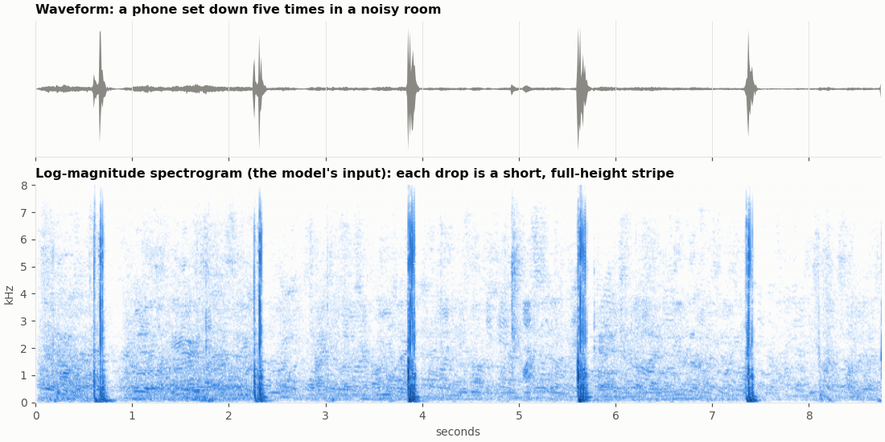
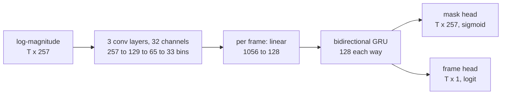
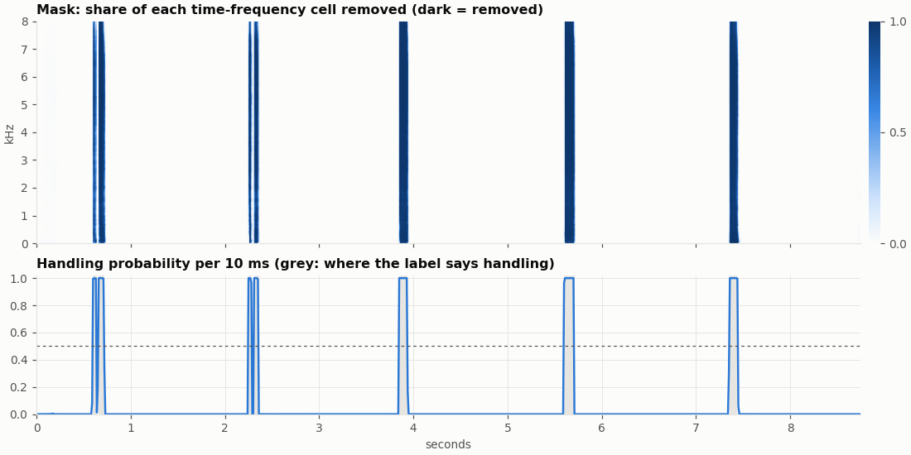
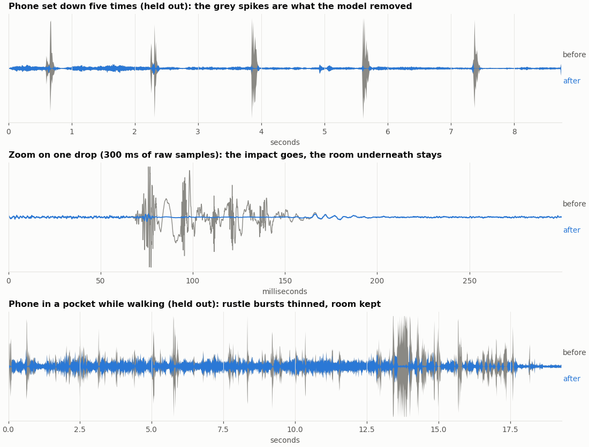
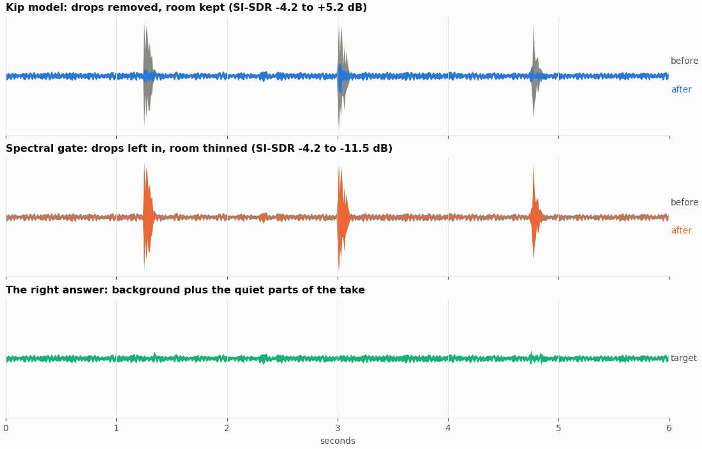
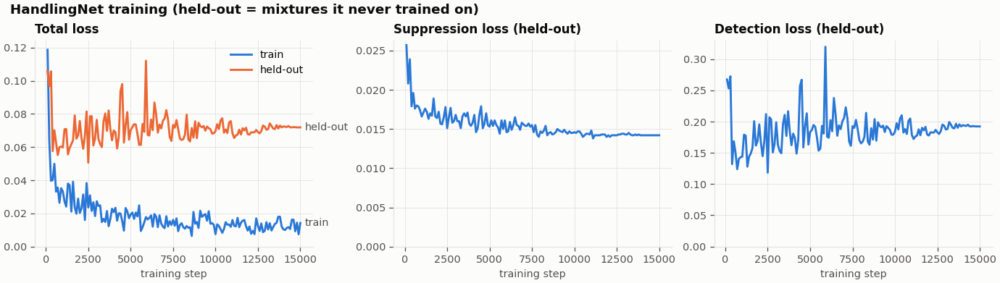
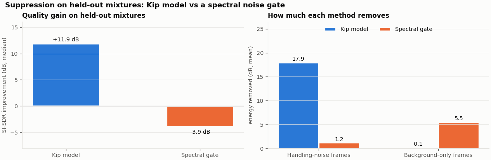

# How the handling filter works

## The problem
A phone recording at night picks up its own handling: fabric rubbing over the microphone, the phone
knocked or set down. To Kip these look like noise spikes. If they reached the wake-up attribution, Kip
would blame the room for noise the phone made itself. The filter finds those moments, removes them, and
leaves everything else alone.

## Input: a spectrogram
The model never sees raw samples. It sees a short-time Fourier transform (STFT) of 16 kHz mono audio:

| Setting | Value | Why |
|---|---|---|
| Window | 25 ms Hann (400 samples), zero-padded to 512 | long enough to resolve frequency, short enough for a knock |
| Hop | 10 ms (160 samples) | one frame every 10 ms |
| Bins | 257, from 0 to 8 kHz, 31.25 Hz apart | |
| Feature | `log(1 + 10 * abs(X))` | a quiet room and a loud knock differ by 30 to 40 dB; the log keeps both visible |

Handling noise has a clear shape in this picture: short, and spread across every frequency at once.
Speech, traffic and snoring have structure in frequency and change more slowly.

## The network

- **Convolutions** look at small time-frequency patches (3 x 5, then 3 x 3) and halve the frequency
  resolution each time. They pick up local shapes, such as a vertical stripe.
- **The GRU** reads the clip forwards and backwards, so each frame is judged against what the room sounds
  like before and after it. A knock is easier to spot when you know the background.
- **Two heads**: a mask with one value per time-frequency cell, and one handling logit per frame.
- 418,754 parameters: `models/handling-poc.pt` (PyTorch) and `models/handling-poc.onnx` (1.6 MB). A 10-second clip takes about 21 ms on one CPU thread in ONNX
  Runtime (90 ms in PyTorch, including the STFT).

## Two outputs
**Mask, for suppression.** Each cell of the input spectrogram X is multiplied by a value M between 0 and 1,
and the inverse STFT turns the result back into audio, reusing the input's phase: `S_hat = M * X`. A mask
can only remove energy, never add sound, which is the safe way for a filter to fail.

**Frame probability, for detection.** `sigmoid(logit) > 0.5` marks a 10 ms frame as handling noise. This
is the part Kip relies on: a spike flagged as handling gets the label `handling` and is never linked to a
wake-up.

On this held-out take the mask removes five narrow columns, one per drop, and leaves the room between
them untouched.

## Before and after
Grey is the recording, blue is what the model kept. Any grey still showing is what it suppressed.

The same held-out mixture through the model and through a spectral noise gate, with the right answer underneath:

More views of the same runs, including spectrograms before and after, are in `reports/handling-gpu/`:
[real drop take](reports/handling-gpu/real_venue_pickup_01.png),
[walking-pocket take](reports/handling-gpu/real_venue_pocket_02.png),
[mixture waveforms](reports/handling-gpu/mixture_waveforms.png),
[mixture spectrograms](reports/handling-gpu/mixture_spectrograms.png).
Before and after audio to listen to is in `reports/handling-gpu/audio/`.

## Training data
There are only about 3 minutes of real handling noise, so training examples are mixed on the fly:

1. a 4-second slice of a night background: ESC-50 clips, plus venue room tone on our own machines;
2. with probability 0.75, a slice of handling noise (our iPhone takes, or synthetic placeholders), scaled
   to between -5 and +20 dB against the background;
3. a random overall level between -30 and -3 dBFS.

Every example is new, so the model cannot memorise the mixtures, only the sounds. Splits are by source
recording, so no test sound is ever heard in training.

**Labels.** A 10 ms frame counts as handling noise when the take is louder there than its own quiet floor
by 8 dB, and louder than the venue: the 90th percentile of the venue room tone, plus 3 dB. Our takes were
recorded in a loud hall; without the second condition, the crowd behind them would be labelled as handling.

**Target.** The background plus the quiet parts of the take. The model learns to remove the bursts, not
the room around them.

## Loss
`L = mean(abs((M * abs(X))^0.3 - abs(S)^0.3)) + 0.3 * BCE(logit, label)`

- The first term compares the cleaned spectrogram with the target. The 0.3 power compresses magnitudes
  roughly the way hearing does, so quiet detail still counts next to a loud knock.
- The second term trains the frame detector.

AdamW, learning rate 0.002 with cosine decay, batch 32, 15,000 steps, gradients clipped at 5: 15 minutes
on an RTX 3090.

## How it is measured
Every number below is on mixtures and recordings the model never trained on.

- **SI-SDR improvement**: the scale-invariant signal-to-distortion ratio of the output against the target,
  minus the same for the input. With `a = <s_hat, s> / |s|^2`,
  `SI-SDR = 10 * log10(|a*s|^2 / |a*s - s_hat|^2)`. Higher is better, and overall volume does not matter.
- **Energy removed** per frame, split into frames that are handling noise and frames that are not. The
  ideal is a lot, then nothing.
- **Precision and recall** of the frame detector against the labels.

**Baseline: spectral gating.** The standard noise-reduction method estimates each frequency's steady level
(here the 20th percentile over time) and subtracts it. That assumes stationary noise. Handling noise is the
opposite, short bursts far above any steady level, so a gate mostly leaves it and takes its cut from the
room instead.

## Results

| Held-out | Model | Spectral gate |
|---|---|---|
| SI-SDR improvement, median of 150 mixtures | +11.9 dB | -3.9 dB |
| Energy removed on handling frames | 17.9 dB | 1.2 dB |
| Energy removed on room-only frames | 0.15 dB | 5.5 dB |
| Frame detection, precision / recall | 0.90 / 0.92 | n/a |
| Real drop take, precision / recall | 0.96 / 1.00 | n/a |
| Real drop take, energy removed on the drops / elsewhere | 27.8 / 0.2 dB | n/a |

## Limits
- Trained on one iPhone in one loud hall. Expect it to work best on that kind of recording.
- Strongest on knocks and drops. Slow rustling is caught less often and removed less: on the held-out
  walking-pocket take, recall 0.73 and 12.5 dB removed.
- Rustling quieter than the room is not labelled as handling, by design: it cannot cause a spike.
- ESC-50 is CC BY-NC 3.0, so this model is for the prototype only.

## Where it runs
The plan (#90, #91): the API computes the STFT, runs `models/handling-poc.onnx`, applies the mask and reads
the frame probabilities (the contract is in `models/README.md`). Spikes whose frames are mostly handling are
labelled `handling` and skip Gemini. To try it on any recording: `uv run python -m kipml.infer <file>`.
Regenerate the two figures above with `uv run python scripts/make_doc_figures.py`.
