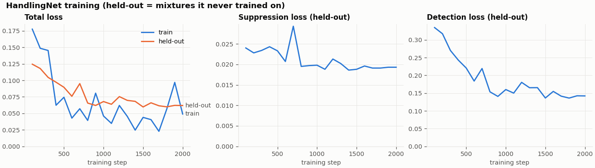
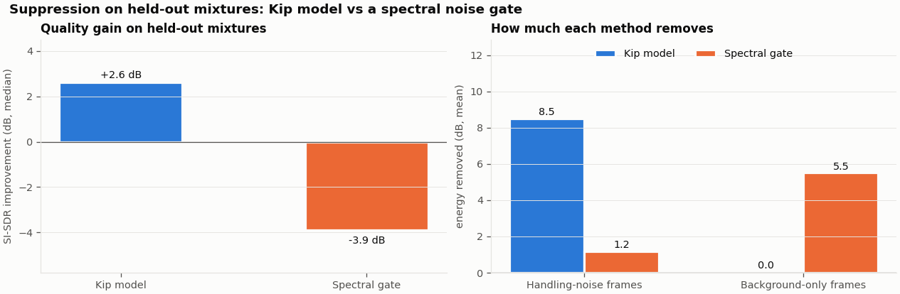
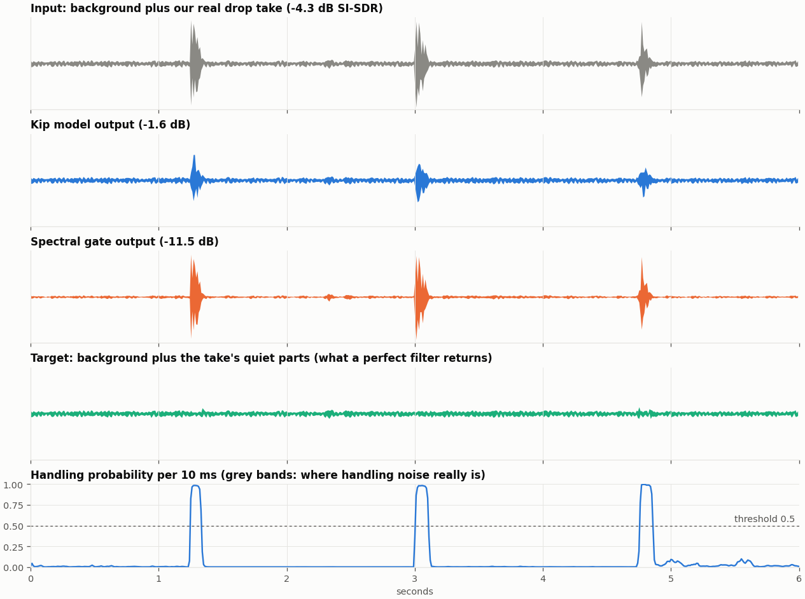
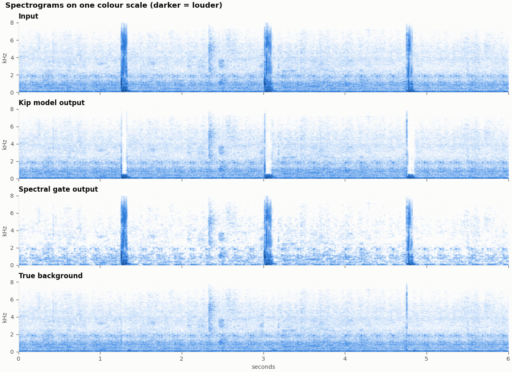
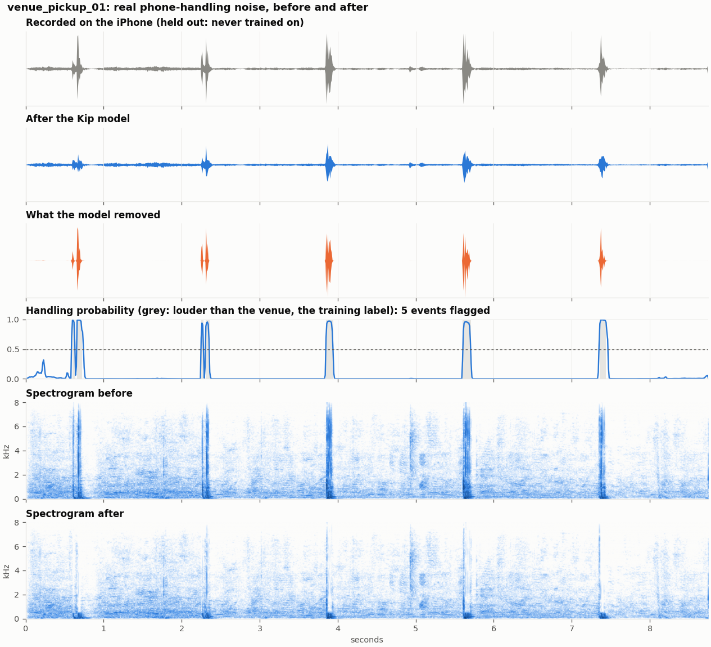
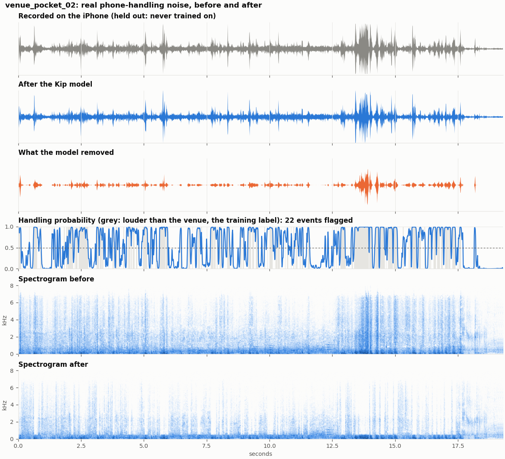
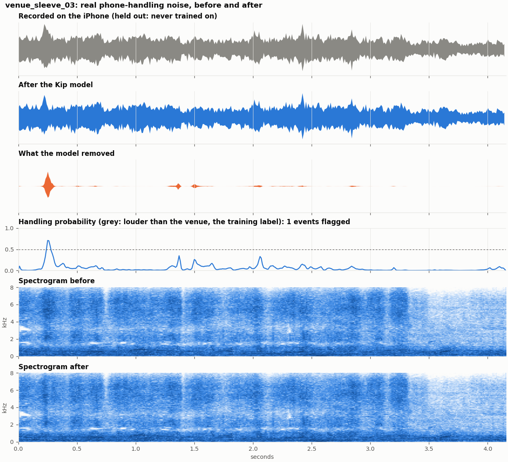

# HandlingNet proof of concept (handling-poc)

Trained 2000 steps in 11 min. Every number below is on audio the model never trained on. Regenerate with `uv run python -m kipml.report`.

| Metric | Kip model | Spectral gate |
|---|---|---|
| SI-SDR improvement, median (150 mixtures) | +2.6 dB | -3.9 dB |
| Energy removed on handling-noise frames | 8.5 dB | 1.2 dB |
| Energy removed on background-only frames | 0.0 dB | 5.5 dB |
| Handling-frame detection (precision / recall / F1) | 0.84 / 0.93 / 0.88 | n/a |

Real held-out takes from the iPhone, scored against the training label rule (louder than the venue):

| Take | Length | Handling (label) | Flagged | Precision / recall | Removed on handling | Removed elsewhere |
|---|---|---|---|---|---|---|
| `venue_pickup_01` | 8.8 s | 0.46 s | 0.53 s | 0.85 / 0.98 | 3.1 dB | 0.0 dB |
| `venue_pocket_02` | 19.3 s | 6.93 s | 10.57 s | 0.64 / 0.98 | 0.5 dB | 0.4 dB |
| `venue_sleeve_03` | 4.2 s | 0.0 s | 0.04 s | 0.0 / 0.0 | None dB | 0.1 dB |

## Training

## Suppression compared

## A held-out mixture with ground truth

## Real takes from the phone

## Listen

Before and after files are in `audio/`: `mixture_input.wav`, `mixture_kip.wav`, `mixture_gate.wav`, `mixture_true_background.wav`, and `<take>_input.wav` / `<take>_kip.wav` for each real take.
